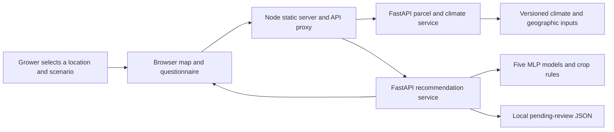

# BioTinder | AgroRota Ecuador

**An interactive prototype for planning rice rotations in Babahoyo, Los Ríos, Ecuador.** Built for the NASA Space Apps Challenge 2026 project context.

Rice growers deciding what to plant after harvest need to weigh seasonal rain, drainage, irrigation and the cost of a second crop. BioTinder lets users inspect local environmental layers and compare current practice with two alternative rotations over 18 simulated months.

| Start here | What you will find |
| --- | --- |
| [Run the full prototype](proyecto-agricultura-ia/README.md#ejecutar-biotinder-localmente) | The browser viewer and its two local FastAPI services |
| [Data and model evidence](docs/data_and_model.md) | Provenance, reproducible checks and limits of the reported metrics |
| [Repository audit](docs/reorganization_audit.md) | Inventory, placeholders and paths kept stable |
| [Verification and handoff](docs/reorganization_report.md) | Tests, file changes and remaining work |

## What works today

- **Map and location check.** Select a point in Babahoyo and inspect monthly rainfall, a one-day SMAP sample and monthly day/night land-surface temperature. The rainfall card includes a historical chart and a three-month climatological reference.
- **Rotation comparison.** Enter the growing sector, current practice, start month, summer water source, terrain, goal and scenario. Inspect three strategy cards and their 18-month calendars.
- **Optional local layers.** Download parish boundaries and flood susceptibility with the documented setup command. Susceptibility classes describe terrain exposure. They do not show active flooding.
- **Field observations.** Submit notes to a local file marked pending review. A review interface, production authentication and multi-user storage remain pending.
- **Static preview.** GitHub Pages packaging exists for the saved Pimocha example. Public deployment has not been activated.

## Architecture



The map and recommendation APIs are separate. Map layers provide context for the grower. The recommendation service uses a sector and scenario with stored climatology, a neural ensemble and hard-coded crop rules. Picking a map cell does not feed its satellite values directly into inference.

## Data in the prototype

| Source | Period and scale | Actual use |
| --- | --- | --- |
| [NASA POWER](https://power.larc.nasa.gov/) | Monthly targets and climate inputs for 2005–2024 at eight query points. Native grid depends on the variable. | Training script requests POWER and has a synthetic fallback. The checked-in CSV differs from that fallback and matches the artifact's climatology. Raw request provenance is incomplete. |
| [NASA GPM IMERG Final V07B](https://doi.org/10.5067/GPM/IMERG/3B-MONTH/07) | January 2010–September 2025 at 0.1° | Rainfall cells and canton history in the map |
| [NASA SMAP L4 V8](https://doi.org/10.5067/T5RUATAQREF8) | January 1, 2025 sample at 9 km and 3-hour intervals | Surface and root-zone moisture in the map |
| [NASA Terra MODIS MOD11C3.061](https://doi.org/10.5067/MODIS/MOD11C3.061) | January 2010–October 2026, monthly at 0.05° | Day/night land-surface temperature with quality filtering |
| [ISRIC SoilGrids](https://docs.isric.org/globaldata/soilgrids/) and Ecuadorian references | SoilGrids v2 at 250 m, plus source-specific agricultural and geographic scales | Reference and audit materials. SoilGrids values are not read by the recommendation endpoint. |

See the [data and model notes](docs/data_and_model.md) for MODIS vegetation, SRTM, crop rules, and products collected but not integrated.

## Run locally

Use Python 3.11–3.13 and Node.js 22 or newer. Run the commands below in three PowerShell terminals, each starting at the repository root. Use separate virtual environments if you want to isolate the Python dependencies.

```powershell
# Terminal 1 — recommendation API
python -m pip install -r requirements.txt
python -m uvicorn backend.app:app --host 127.0.0.1 --port 8000
```

```powershell
# Terminal 2 — parcel and climate API
cd proyecto-agricultura-ia/backend
python -m pip install -r requirements.txt
python -m uvicorn app.main:app --host 127.0.0.1 --port 8001
```

```powershell
# Terminal 3 — map preparation and viewer
node proyecto-agricultura-ia/scripts/preparar_cartografia.mjs
$env:BACKEND_URL = 'http://127.0.0.1:8001'
$env:AI_BACKEND_URL = 'http://127.0.0.1:8000'
cd proyecto-agricultura-ia/frontend
npm start
```

Open [the local viewer](http://127.0.0.1:5173/), [recommendation API docs](http://127.0.0.1:8000/docs) or [map API docs](http://127.0.0.1:8001/docs). A location to try is longitude `-79.526`, latitude `-1.802`. External basemaps and optional cartographic layers require network access. Runtime inference uses the checked-in model and requires no live NASA requests.

### API example

POST this JSON to `/api/recomendar` on port 8000:

```json
{
  "zona": "Pimocha (Bajial)",
  "manejo_actual": "arroz_barbecho",
  "mes_inicio": 5,
  "agua_verano": "solo_lluvia",
  "tipo_terreno": "bajial_inundable",
  "meta": "resistir_sequia",
  "escenario_clima": "sequia"
}
```

The response contains `zona`, `metricas_modelo` and three `estrategias`, each with an 18-record `timeline`. See the [saved full response for Pimocha](proyecto-agricultura-ia/frontend/pages/pimocha-demo.json). The map uses `/api/v1/parcels/validate` and `/api/v1/climate/babahoyo/*`. `POST /api/aportar-datos` accepts `sector`, `categoria` and `observacion` and stores a pending record.

## Method and limits

The model artifact holds five MLP regressors with hidden layers of 64 and 32 units. The dataset uses eight sectors and a random 80/20 holdout. The stored metrics summarize that internal experiment. They do not establish accuracy for a new year, location or field. Scenario changes, agronomic guidance, economic assumptions and the ensemble-stability score are documented separately. A monthly climatological reference and an 18-month scenario are both different from an operational forecast. [Method and reproducibility](docs/data_and_model.md)

Next evidence to collect includes source request manifests and units, time-and-location holdouts, field measurements and dated crop costs. See the [Spanish operating guide](proyecto-agricultura-ia/README.md) and [data inventory](INVENTARIO_PRIORIZADO.md).

Contributor history is available through Git. Team credits, a project-wide license and an AI-use disclosure have not been confirmed. Individual data and library terms still apply.
